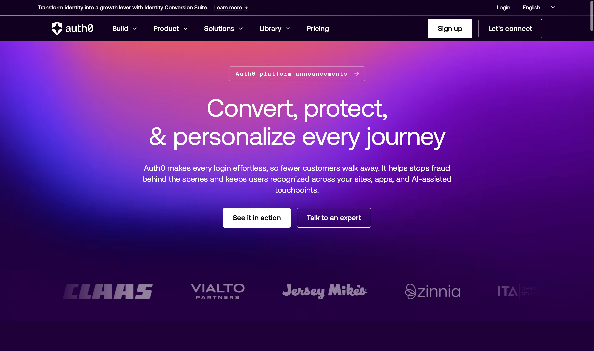
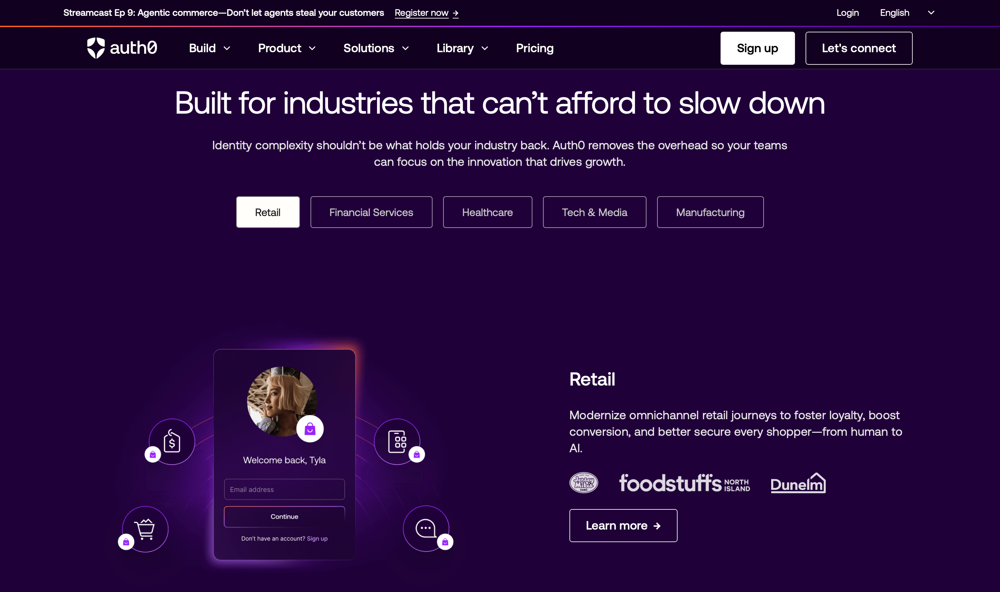
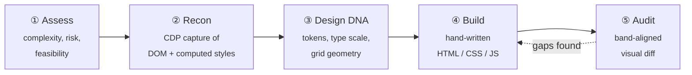

<div align="center">

# Auth0 Homepage — Faithful Front-End Reconstruction

**A pixel-faithful, dependency-free static rebuild of [auth0.com](https://auth0.com/) — reverse-engineered from computed styles, not eyeballed.**

[](https://auth0-frontend-clone.vercel.app/)

[](#)
[](#)
[](#)
[](#)
[](#)
[](https://auth0-frontend-clone.vercel.app/)
[](#-license--attribution)

</div>

---

> [!IMPORTANT]
> **This is an unaffiliated educational study, not a product.** Every trademark, logo, photograph, font and line of marketing copy belongs to **Okta, Inc. (Auth0)**. This repository exists to document a reverse-engineering and front-end reconstruction workflow — it is not endorsed by, affiliated with, or connected to Okta/Auth0 in any way. See **[License & Attribution](#-license--attribution)** before you fork, deploy, or reuse anything here.

---

## Table of Contents

- [Overview](#-overview)
- [Screenshots](#-screenshots)
- [Why This Project Exists](#-why-this-project-exists)
- [Fidelity Scorecard](#-fidelity-scorecard)
- [Tech Stack](#-tech-stack)
- [Project Structure](#-project-structure)
- [The Clone Pipeline](#-the-clone-pipeline)
- [Design Tokens](#-design-tokens)
- [Interactive Systems](#-interactive-systems)
- [Accessibility & Motion](#-accessibility--motion)
- [Recon Evidence](#-recon-evidence)
- [Getting Started](#-getting-started)
- [Deployment](#-deployment)
- [Deliberate Deviations from the Original](#-deliberate-deviations-from-the-original)
- [Known Limitations](#-known-limitations)
- [Lessons Learned](#-lessons-learned)
- [License & Attribution](#-license--attribution)

---

## Overview

The live auth0.com homepage is a **Next.js + React + styled-components** application: 102 scripts, 4 stylesheets, hashed `sc-*` class names, and a 10,151px-tall marketing surface with five independent interactive systems.

This repository rebuilds that page as **three hand-written files** — one HTML document, one stylesheet, one script — with **zero dependencies, zero build step, and zero runtime framework**. Every colour, font size, letter-spacing and box metric was lifted from `getComputedStyle()` on the real site via the Chrome DevTools Protocol, then transcribed verbatim. Nothing was approximated by eye.

<table>
<tr><td><b>Source</b></td><td><a href="https://auth0.com/">https://auth0.com/</a> — captured 2026-10-21</td></tr>
<tr><td><b>Live rebuild</b></td><td><a href="https://auth0-frontend-clone.vercel.app/">auth0-frontend-clone.vercel.app</a></td></tr>
<tr><td><b>Original stack</b></td><td>Next.js · React · styled-components · self-hosted Aeonik webfonts</td></tr>
<tr><td><b>Rebuild stack</b></td><td>Semantic HTML5 · modern CSS (custom properties, grid, flex, <code>clamp</code>) · ES5-safe vanilla JS</td></tr>
<tr><td><b>Hand-written code</b></td><td>~2,430 lines (837 HTML · 1,227 CSS · 366 JS)</td></tr>
<tr><td><b>Self-hosted assets</b></td><td>19 MB — 318 images, 6 <code>.webm</code> gradients, 11 webfont files</td></tr>
<tr><td><b>Breakpoints</b></td><td>1440 → 1240 → 1024 → 900 → 390</td></tr>
<tr><td><b>Complexity rating</b></td><td><b>L4</b> — content-heavy, five interactive systems, no 3D/shader work</td></tr>
</table>

---

## Screenshots

### Hero — gradient video, announcement ticker, customer marquee



> The hero background is the original autoplaying `.webm` gradient (1920×1080 desktop / 720×1280 mobile variants), with the real **Aeonik** display face at 64/72 and `letter-spacing: -1px`. The announcement ticker rotates through four captured messages on a 7-second interval; the logo marquee duplicates its track once so a `-50%` translate loops seamlessly.

### Industries — tabbed panels with per-industry artwork



> Five industry tabs (Retail · Financial Services · Healthcare · Tech & Media · Manufacturing), each with its own copy, customer logo row, and composed illustration. Tab copy for every state was extracted from the live DOM into `RECON/tab-states.json` rather than retyped.

<details>
<summary><b>More reference captures in this repository</b></summary>

| What | Where |
|---|---|
| Full-page originals at 1440 / 768 / 390 | `RECON/screenshots/original-*.png` |
| Original section bands at 1440 (13 slices) | `RECON/crops/band-*.png` |
| Rebuild section bands at 1440 (13 slices) | `RECON/clone-crops/band-*.png` |
| 23 hover/click/scroll interaction states | `RECON/interactions/screenshots/` |
| 10 crawled sub-routes | `RECON/routes/screenshots/` |

The `crops/` and `clone-crops/` directories are band-for-band aligned, so any two files with the same name are a direct before/after comparison.

</details>

---

## Why This Project Exists

This started as a single question: **how far can an AI-assisted cloning pipeline actually get against a production marketing site?**

The answer turned out to be *further than expected* — which made the project worth documenting. Concretely, it is a study in:

| Goal | What it produced |
|---|---|
| **Evaluate automated cloning** | A measurable fidelity baseline against a real L4 target, with the failure modes written down instead of hand-waved |
| **Practise evidence-driven rebuilds** | A workflow where every token traces to a recorded computed value — `--bg: #20003A` exists because `palette.body.backgroundColor` was `rgb(32, 0, 58)`, not because it looked close |
| **Prove the "no-framework" ceiling** | Five interactive systems, five mega-menus and a 4-state animated SVG arc, in 366 lines of dependency-free JS |
| **Build reusable tooling** | 14 CDP-driven recon scripts that work against *any* site, not just this one |

---

## Fidelity Scorecard

| Status | Scope |
|:---:|---|
| 🟢 **Cloned 1:1** | Layout & type scale · full colour system · all marketing copy · hero gradient video · logo marquee · stats strip · scroll-driven tabber · industry tabs · coding-agent tabs · customer bento · resource cards · footer · five mega-menus · responsive behaviour at 1440/768/390 |
| 🟡 **Approximated** | Lifecycle arc auto-advance easing (the original's timing curve is not recoverable from the DOM) · product mega-menu "featured content" column (only partially exposed by the DOM walk) · nav dropdown enter/exit transitions |
| 🔴 **Intentionally omitted** | Login / signup · the Auth0 dashboard · site search · OneTrust consent manager · functional language switching (the selector renders but does not swap content) · **all** analytics and ad pixels · every server-side behaviour behind the marketing shell |

---

## 🛠 Tech Stack

### Runtime — what ships

| Layer | Choice | Rationale |
|---|---|---|
| **Markup** | Semantic HTML5, single document | Landmarks (`header`/`nav`/`main`/`section`/`footer`), skip-link, 128 ARIA attributes |
| **Styling** | One stylesheet, 21 CSS custom properties | Token-first: the whole palette and type scale live in `:root` |
| **Layout** | CSS Grid + Flexbox, 1248px content column | Matches the original's 1440 viewport / 96px gutter geometry |
| **Behaviour** | ES5-safe IIFE, no modules, no polyfills | Zero bundler; opens over `file://` or any static server |
| **Motion** | Native `<video>`, CSS keyframes, `rAF`-throttled scroll | No GSAP, no Lenis, no scroll library — the original has none either |
| **Assets** | Fully self-hosted under `assets/` | Nothing hotlinks `cdn.auth0.com`; the page works offline |

### Tooling — what built it

| Tool | Role |
|---|---|
| **OpenDesign `web-clone` skill** | The cloning playbook: assessment → recon → design-DNA → build → audit |
| **Chrome DevTools Protocol** (system Chrome) | Computed-style extraction, tiled screenshots, network capture, interaction probing |
| **Node.js ESM scripts** (`tools/`, 14 files) | Recon, asset harvesting, measurement, content extraction, visual diffing |
| **Vercel** | Static hosting of the finished page |

---

## Project Structure

```
auth0-frontend-clone/
│
├── index.html                  # 837 lines — the entire page, hand-written
├── assets/
│   ├── site.css                # 1,227 lines — tokens, layout, 4 media queries
│   ├── site.js                 #   366 lines — 8 behaviour modules, 0 deps
│   ├── fonts/                  # Aeonik + Aeonik Mono (woff2/ttf) + @font-face
│   ├── images/                 # 318 harvested images, mirrored by origin host
│   └── media/                  # 6 .webm gradient loops (~6 MB)
│
├── RECON/                      # 116 MB of captured evidence — the "why" behind every value
│   ├── original-recon.json     # frameworks, palette, fonts, resource inventory
│   ├── original-summary.md     # human-readable recon digest
│   ├── measurements*.json      # computed type / colour / box metrics
│   ├── content-dump.json       # page copy + DOM outline
│   ├── parts.json              # inline SVG icon set, image intrinsic sizes
│   ├── tab-states.json         # real copy for every tab state
│   ├── lifecycle.json, arc.json# lifecycle arc states (B2C + B2B) and geometry
│   ├── nav.json                # five mega-menu trees + ticker items
│   ├── asset-manifest.json     # originalUrl → localPath for all 318 assets
│   ├── screenshots/            # originals at 1440 / 768 / 390
│   ├── crops/ · clone-crops/   # band-aligned before/after slices
│   ├── interactions/           # 23 hover/click/scroll probe states
│   └── routes/                 # 10-route crawl at depth 1
│
├── tools/
│   ├── web-clone-scripts/      # 14 reusable CDP recon scripts (+ 2 local patches)
│   └── *.mjs                   # 10 project-specific extractors & measurers
│
├── docs/screenshots/           # README imagery
└── NOTES.md                    # engineering log: stack detection, risks, deviations
```

---

## The Clone Pipeline

Nothing in this repository was produced by "view source and paste". The build followed a five-stage, evidence-first pipeline:



<table>
<tr><th>Stage</th><th>What happened</th><th>Artefact</th></tr>
<tr>
<td><b>① Assess</b></td>
<td>Framework fingerprinting, interactive-system inventory, trademark/licensing risk register, complexity rating</td>
<td><code>NOTES.md</code></td>
</tr>
<tr>
<td><b>② Recon</b></td>
<td>Headless CDP session against the live site: full-page screenshots at three viewports, <code>getComputedStyle()</code> dumps, font-face enumeration, 117-image resource inventory, 23-step interaction probe, 10-route crawl</td>
<td><code>RECON/*.json</code>, <code>RECON/screenshots/</code></td>
</tr>
<tr>
<td><b>③ Design DNA</b></td>
<td>Computed values distilled into a token table — palette, type scale, grid, hairlines — each with a traceable provenance column</td>
<td><a href="#-design-tokens">Design Tokens</a></td>
</tr>
<tr>
<td><b>④ Build</b></td>
<td>Page written by hand against the tokens; copy and asset paths injected from the recon dumps rather than retyped, so a typo in marketing text is structurally impossible</td>
<td><code>index.html</code>, <code>assets/</code></td>
</tr>
<tr>
<td><b>⑤ Audit</b></td>
<td>The rebuild re-screenshotted with the same tiling routine and sliced into the same 13 bands, giving a direct band-for-band comparison against the original</td>
<td><code>RECON/clone-crops/</code> vs <code>RECON/crops/</code></td>
</tr>
</table>

### Two engineering problems worth noting

<details open>
<summary><b>Tiled full-page screenshots</b> — because a 10,151px capture kills the CDP socket</summary>

<br>

A single `Page.captureScreenshot` of the full 1440×10151 surface reproducibly tore down the DevTools websocket (`CDP connection closed`). The patched capture routine in `tools/web-clone-scripts/lib/system-browser.mjs`:

1. Captures **viewport-height bands** addressed by document `y` — exploiting the fact that `captureBeyondViewport` treats clip coordinates as document coordinates.
2. Stitches them on a scratch page's `<canvas>`.
3. Moves tiles and the stitched PNG **one chunk per CDP message**, because a single multi-megabyte `Runtime.evaluate` payload also drops the socket.

This is what makes the band-aligned before/after diff possible at all.

</details>

<details>
<summary><b>Consent-modal dismissal</b> — because OneTrust poisons the palette</summary>

<br>

The OneTrust cookie modal covers the fold, which corrupts both the hero screenshots *and* every computed colour read from elements behind the overlay. Recon runs the dismissal path behind an `OD_CLONE_DISMISS_CONSENT=1` flag before any capture, so the palette in `RECON/original-recon.json` reflects the real page rather than a dimmed one.

</details>

---

## Design Tokens

Every value below was **copied from a recorded computed style**, not picked by eye. The provenance column is the point.

| Token | Value | Source |
|---|---|---|
| `--bg` | `#20003A` | `palette.body.backgroundColor` = `rgb(32, 0, 58)` |
| `--surface` | `#120021` | `palette.nav/footer.backgroundColor` = `rgb(18, 0, 33)` |
| `--fg` | `#FFFEFA` | `palette.body.color` = `rgb(255, 254, 250)` |
| `--fg-strong` | `#FFFFFF` | heading colour |
| `--mono-accent` | `#EBD3FF` | mono eyebrow colour = `rgb(235, 211, 255)` |
| `--accent` | `#9921FE` | `rgb(153, 33, 254)` — card gradient, footer CTA, tab progress |
| `--accent-deep` | `#490186` | ticker `border-image` stop |
| `--accent-orange` | `#FF6217` | ticker `border-image` stop |
| `--hairline` | `rgba(255,255,255,0.33)` | card / stat / footer borders |
| Display + body face | `Aeonik, sans-serif` | `palette.*.fontFamily` |
| Mono face | `"Aeonik Mono", monospace` | eyebrow + badge computed `fontFamily` |

<details>
<summary><b>Type scale & grid geometry</b></summary>

<br>

All Aeonik, with `letter-spacing: -1px` on display sizes:

| Size / line-height | Used by |
|---|---|
| `64 / 72` | Hero headline, final CTA |
| `56 / 64` | Lifecycle section `h2` |
| `48 / 56` | Section `h2`, stat values |
| `40 / 48` | Tabber title |
| `32 / 44` | Card titles |
| `20 / 28` | Hero sub-headline |
| `18 / 28` | Buttons, nav (weight 500) |
| `16 / 22` | Pills |
| `14 / 28` | Body copy |
| `14 / 20`, `ls 1.5px`, uppercase | Mono eyebrows |

**Grid:** a 1248px content column inside a 1440px viewport (96px gutters). `main` is a flex column with a 128px section gap and `banner-gradient-lg.png` as a `contain / 50% 100%` background.

</details>

---

## Interactive Systems

Nine sections, eight behaviour modules, **366 lines of JavaScript, no dependencies.**

| # | System | Behaviour | Implementation note |
|:-:|---|---|---|
| 1 | **Announcement ticker** | Rotates 4 captured messages + CTAs every 7 s | Pauses entirely under `prefers-reduced-motion` |
| 2 | **Five mega-menus** | Hover to open ≥901px, click to toggle below; `Escape` and outside-click close all | Full `aria-expanded` bookkeeping; one open panel at a time |
| 3 | **Logo marquee** | 16 customer logos scrolling seamlessly | Track rendered twice so a `-50%` translate loops with no seam |
| 4 | **Lifecycle arc** | 4-state SVG arc with B2C ⇄ B2B mode switch, 4.2 s auto-advance, click-to-jump, pause on hover | State data lives in a single `LIFECYCLE` object; `aria-pressed` tracks the active node |
| 5 | **Scroll-driven tabber** | The sticky left list follows whichever card you are reading | Picks the card nearest the **viewport centre** rather than using an `IntersectionObserver` band — a band leaves the state stuck when no card is inside it, and fails above the first card |
| 6 | **Industry tabs** | 5 panels, each with its own copy, logo row and artwork | Shared `wireTabs()` helper; `aria-selected` + `hidden` |
| 7 | **Coding-agent tabs** | 4 panels | Same helper |
| 8 | **Resource tabs** | 16 cards across 4 panels, rendered from data | Card kind (`Whitepaper`/`Webinar`/`Video`/`Podcast`) selects a doc or play icon |
| 9 | **Copy-to-clipboard** | Snippet buttons with a toast confirmation | `navigator.clipboard` with a `execCommand` fallback for non-secure contexts |

**Scroll performance:** the tabber's scroll handler is `requestAnimationFrame`-throttled behind a `ticking` guard and registered `{ passive: true }`, so it never blocks the compositor.

---

## Accessibility & Motion

The original ships a framework-generated DOM; this rebuild takes the opportunity to be deliberate about semantics.

- **Skip link** to `#main` as the first focusable element
- **Landmark structure** — `header` · `nav[aria-label="Primary"]` · `main` · `section` · `footer`
- **128 ARIA attributes**, applied where they carry meaning:
  `aria-hidden` (54, decorative SVG) · `aria-selected` (13, tab panels) · `aria-label` (11) · `aria-expanded` (5, mega-menus + mobile toggle) · `aria-current` (4, tabber) · `aria-pressed` (2, lifecycle nodes) · `aria-live` (2, ticker + toast) · `aria-controls` (1)
- **Keyboard support** — `Escape` closes every open mega-menu; all interactive affordances are real `<button>` / `<a>` elements, never click-bound `<div>`s
- **Labelled controls** — the language `<select>` carries a visually-hidden `<label>`
- **`prefers-reduced-motion: reduce`** is honoured in *both* layers: CSS suppresses transitions and marquee animation, and JS short-circuits the ticker interval, the lifecycle auto-advance, and smooth-scroll behaviour

---

## Recon Evidence

Everything in `RECON/` (116 MB, 77 files) is kept on purpose — it is the audit trail that makes "faithful" a verifiable claim rather than an adjective.

| Artefact | Path |
|---|---|
| Recon JSON + summary (frameworks, palette, fonts, resources) | `RECON/original-recon.json`, `RECON/original-summary.md` |
| Full-page screenshots at 1440 / 768 / 390 | `RECON/screenshots/original-*.png` |
| Section reference bands at 1440 | `RECON/crops/band-*.png` |
| Rebuild bands at 1440 (band-aligned with the above) | `RECON/clone-crops/band-*.png` |
| Downloaded asset map (`originalUrl` → `localPath`) | `RECON/asset-manifest.json` |
| Computed type / colour / box measurements | `RECON/measurements.json`, `RECON/measurements-2.json` |
| Page copy + DOM outline | `RECON/content-dump.json` |
| Inline SVG icon set, image intrinsic sizes | `RECON/parts.json` |
| Real copy for every tab state | `RECON/tab-states.json` |
| Lifecycle arc states (B2C + B2B) and geometry | `RECON/lifecycle.json`, `RECON/arc.json` |
| Mega-menu trees + ticker items | `RECON/nav.json` |
| Interaction probe (hover / click / scroll, 23 states) | `RECON/interactions/` |
| Route map (10 routes, depth 1) | `RECON/routes/` |

> **Note on repository size** — the evidence directory dominates the clone (116 MB of 135 MB). If you only want the page, `git clone --filter=blob:none` or sparse-checkout `index.html` + `assets/`.

---

## Getting Started

**Requirements:** none. No Node, no package manager, no build step.

```bash
git clone https://github.com/maaitlunghau/auth0-frontend-clone.git
cd auth0-frontend-clone

# Any static server will do:
python3 -m http.server 8123
#   or: npx serve .
#   or: php -S localhost:8123

open http://127.0.0.1:8123/
```

> A server is recommended over `file://` so the `.webm` gradients and webfonts load with correct MIME types.

<details>
<summary><b>Re-running the recon pipeline against a live site</b></summary>

<br>

The scripts under `tools/web-clone-scripts/` are generic — they work against any URL, not just auth0.com. They drive the **system Chrome** over CDP:

```bash
env -u OD_DAEMON_URL \
    OD_BROWSER_EXECUTABLE_PATH="/Applications/Google Chrome.app/Contents/MacOS/Google Chrome" \
    OD_CLONE_DISMISS_CONSENT=1 \
    node tools/web-clone-scripts/recon-site.mjs https://example.com/
```

| Script | Purpose |
|---|---|
| `recon-site.mjs` | Framework detection, palette, fonts, resource inventory, multi-viewport screenshots |
| `asset-harvest.mjs` | Downloads every referenced asset and writes `asset-manifest.json` |
| `interaction-probe.mjs` | Walks hover / click / scroll states and screenshots each one |
| `route-crawl.mjs` | Crawls sub-routes to a given depth |
| `network-capture.mjs` | Records the full request waterfall |
| `sourcemap-hunt.mjs` | Looks for exposed source maps |
| `dna-scaffold.mjs` | Emits a token scaffold from the recon output |
| `visual-diff.mjs` / `compare-recon.mjs` / `audit-clone.mjs` | Compare the rebuild against the original |
| `mirror-site.mjs` | Static mirror fallback |

`tools/web-clone-scripts/` is a **project-local copy** of the skill's scripts, carrying two patches to `lib/system-browser.mjs` (tiled screenshots, consent dismissal) described in [The Clone Pipeline](#-the-clone-pipeline).

</details>

---

## Deployment

Deployed on **Vercel** as a pure static site — no framework preset, no build command, no output directory configuration. The repository root *is* the deployable artefact.

| | |
|---|---|
| **Production** | https://auth0-frontend-clone.vercel.app/ |
| **Build command** | *(none)* |
| **Output directory** | `.` |
| **Runtime** | Static CDN only |

Because every asset is relative and self-hosted, the same tree deploys unchanged to GitHub Pages, Netlify, Cloudflare Pages, or any bucket behind a CDN.

---

## Deliberate Deviations from the Original

These are not bugs — they are choices, each made for a stated reason.

| Change | Reason |
|---|---|
| **All analytics, ad and heatmap tags removed** — GTM, GA, LinkedIn, X, Quora, 6sense, Bizible, AdRoll, TechTarget, StackAdapt, Heap, PubMatic, Rubicon, OpenX, Taboola, Outbrain, Tapad, TVSquared, Everest, BidSwitch, Casale, 3lift, Smart AdServer, ml314, pippio, DoubleClick | A study rebuild must not emit tracking beacons to third parties |
| **OneTrust cookie banner removed** | It exists to gate the tracking that no longer runs |
| **Fonts, images and video self-hosted** with relative paths | Nothing hotlinks `cdn.auth0.com`; the page is reproducible offline |
| **Hero CTA pinned** to the "See it in action / Talk to an expert" variant | The original A/B-tests this slot against an email capture — a pixel diff against a rotating variant is meaningless |
| **Announcement ticker rotates a fixed set** of the real captured messages | The live ticker is server-driven and changes between visits |

---

## Known Limitations

- **Pixel diff will never reach 100 %.** The original A/B-tests its hero CTA and rotates the announcement ticker server-side; two captures of the real site do not match each other either.
- **Lifecycle arc easing is approximated.** Timing curves are not recoverable from a DOM snapshot — only the state machine and its geometry are.
- **The product mega-menu's "featured content" column is partial.** The DOM walk did not fully expose it.
- **The language selector is decorative.** It renders and is labelled, but does not swap content — localisation is a server concern.
- **Heavy repository.** 116 MB of recon evidence. See the sparse-checkout note above.
- **Single page, single route.** Sub-routes were crawled for reference only; nothing beyond `/` is rebuilt.

---

## Lessons Learned

1. **Computed styles beat screenshots.** A colour picker on a PNG gives you a plausible hex. `getComputedStyle()` gives you `rgb(32, 0, 58)` with a provenance trail — and a README table you can defend.
2. **Extract copy as data, then inject it.** Marketing text retyped by hand accumulates silent typos. Driving `index.html` and `site.js` from `content-dump.json` / `tab-states.json` / `nav.json` makes a whole error class structurally impossible.
3. **Viewport-centre beats `IntersectionObserver`** for "which card am I reading". A threshold band leaves the last-fired state stuck when nothing is inside it, and gives the wrong answer above the first card. Nearest-centre is both simpler and more correct.
4. **A framework-free rebuild is plausible at this scale.** 102 scripts of Next.js + styled-components collapsed into 366 lines of vanilla JS without losing an interaction — the framework was serving the *authoring* experience, not the page.
5. **The hard part is infrastructure, not CSS.** The two genuine engineering problems were a CDP socket that dies on tall captures and a consent modal that poisons computed colours. The actual page was the easy half.
6. **Write the legal register during assessment, not after deploy.** Trademarks, non-redistributable webfonts and verbatim copy are structural constraints on what the artefact can become — and they are far cheaper to confront on day one.

---

## License & Attribution

> [!CAUTION]
> **This repository is published for educational and portfolio purposes only. It is not licensed for reuse, redistribution, or commercial deployment.**

**All rights in the original material belong to Okta, Inc. (Auth0).** Specifically, this repository contains, unmodified:

| Third-party material | Rights holder |
|---|---|
| The Auth0 wordmark, favicon and brand iconography | Okta, Inc. |
| Customer logos — McLaren, Siemens, CLAAS, Zapier, Cribl, PGA of America, Jersey Mike's, Vialto Partners, Zinnia, Signify, Bluetooth, Jamf, Arduino, Maven, Wyndham, LA ITA, Foodstuffs, Dunelm, and others | Respective owners |
| Customer photography and composed illustrations | Okta, Inc. and licensors |
| All marketing copy, verbatim | Okta, Inc. |
| Hero and tabber `.webm` gradients | Okta, Inc. |
| **Aeonik** and **Aeonik Mono** webfonts | CoType Foundry — *licensed webfonts, not redistributable* |

**The auth0.com homepage is proprietary, all rights reserved. No part of it is open source.** This rebuild is a non-commercial study reconstruction and is **not** affiliated with, endorsed by, sponsored by, or connected to Okta, Inc. or Auth0.

### If you intend to reuse this as a template

Do **not** deploy or redistribute this tree as-is. Replace, at minimum:

1. The Auth0 wordmark (inline SVG in `index.html`) and the favicon — substitute your own mark
2. Every customer logo and photograph under `assets/images/cdn.auth0.com/`
3. **All copy** — it is Auth0's marketing text, verbatim
4. The hero and tabber `.webm` gradients under `assets/media/`
5. The Aeonik / Aeonik Mono font files — swap for a licensed or open face
6. The `©2026 Okta, Inc.` footer line and every `auth0.com` outbound link

What *is* freely reusable is the **method**: the recon scripts under `tools/`, the token-provenance discipline, the band-aligned audit loop, and the vanilla-JS patterns in `assets/site.js`.

*If you are a rights holder and would like this repository or its deployment taken down, please open an issue — it will be actioned immediately.*

---

## Acknowledgments

- **[Auth0 / Okta, Inc.](https://auth0.com/)** — for a genuinely excellent piece of marketing design worth studying
- **[CoType Foundry](https://www.cotypefoundry.com/aeonik)** — for Aeonik, the typeface that carries the whole page
- **OpenDesign `web-clone` skill** — for the assessment → recon → DNA → build → audit pipeline
- **[Vercel](https://vercel.com/)** — for one-command static hosting

---

<div align="center">

**Built as a front-end reverse-engineering study.**
*Every token traced. Nothing eyeballed.*

[Live Demo](https://auth0-frontend-clone.vercel.app/) · [Engineering Notes](NOTES.md) · [Recon Evidence](RECON/original-summary.md)

</div>
